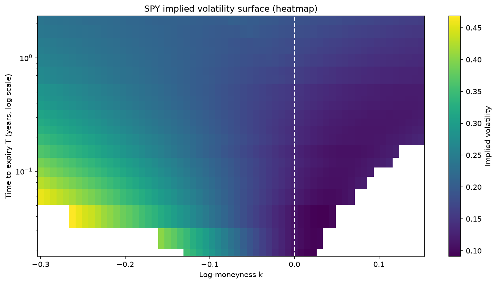
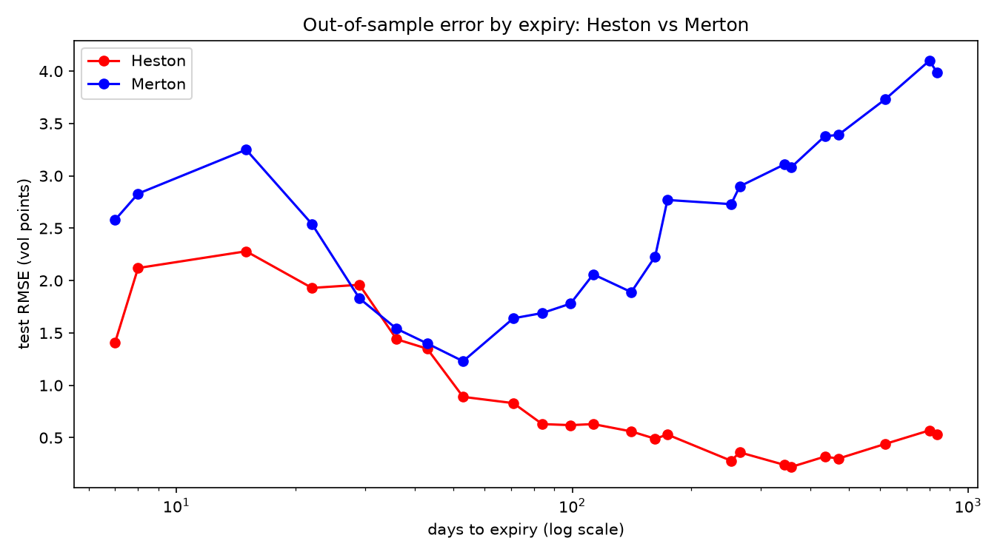
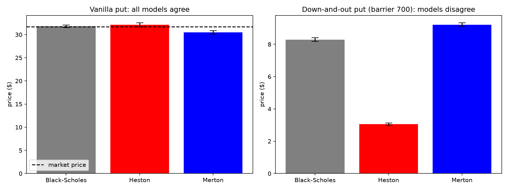
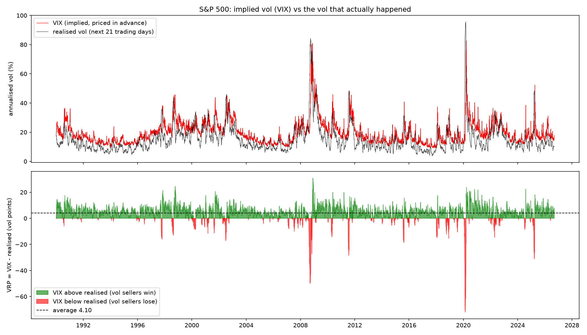

# SPY implied volatility surface: Heston vs Merton

I took one snapshot of the SPY option market (8 October 2026) and worked through it from raw quotes to models. I compute my own implied volatilities, build the volatility surface, calibrate the Heston and Merton models to it, and then use those models for Monte Carlo pricing and delta-hedging experiments. A last part compares 36 years of the VIX with the volatility that actually followed.

Developed locally from September 2026; uploaded to GitHub in October 2026.

## Results

- **Implied vols:** 3,199 out-of-the-money options, priced with my own Black-76 pricer and Brent root-finder. The forward for each of the 24 expiries comes from put-call parity (the Cboe VIX method), not from Yahoo. That fixes a bias in Yahoo's own numbers, where puts came out about 1.8 vol points too low and calls about 1.8 too high.
- **The surface:** ATM vol rises from 10.6% (1 week) to 18.8% (2.3 years). The ATM skew decays like T^(-0.32). After removing 21 bad quotes (3,178 options left) there is no calendar or butterfly arbitrage.
- **Heston vs Merton:** both are calibrated on 480 options and tested on the other 2,698. Heston fits to 0.95 vol points (1.11 out of sample), Merton to 2.94 (2.47 out of sample). Heston is better at 23 of the 24 expiries; Merton only wins on deep puts expiring within 60 days, where jumps matter.
- **Model risk:** all three models agree on a vanilla put. A down-and-out put (strike 785, barrier 700, March 2027) costs 8.29 under Black-Scholes, 3.06 under Heston and 9.21 under Merton.
- **Delta hedging:** the hedging error halves each time rebalancing is 4 times more frequent. Hedging at the wrong vol gives a P&L equal to the price difference between the two vols. With Merton jumps the error stays around 23 dollars however often you rebalance, because jumps can't be hedged.
- **Variance risk premium:** from 1990 to 2026 the VIX was above the volatility that followed on 86% of days, by 4.1 vol points on average. 2008 is the only year with a negative average, and the worst days were in February 2020.

## Notebooks

| Notebook | What it does |
|---|---|
| `01_download_data` | Downloads the full SPY option chain (9,474 options) and cleans it down to 3,199 |
| `02_implied_vol` | Treasury rates, forwards from put-call parity, Black-76 pricer and tests, implied vols, comparison with Yahoo |
| `03_vol_surface` | Spike and butterfly filters, smiles, term structure, skew power law, 3D surface, calendar check, risk-neutral density (Breeden-Litzenberger) |
| `04_calibration` | Heston (characteristic function) and Merton pricers with tests, least-squares calibration, train/test comparison |
| `05_monte_carlo` | Monte Carlo convergence, antithetic and control variates, barrier option under three models, delta hedging, VIX vs realised vol |

The interactive 3D surface is in `figures/vol_surface_3d.html` (download it and open it in a browser).

## Data

All market data comes from Yahoo Finance through `yfinance`: the SPY option chain on 8 October 2026, Treasury yields, and daily S&P 500 and VIX closes since 1990. Yahoo quotes can be delayed and I use mid prices, so the numbers are indicative rather than tradeable. The raw option chain is not included in this repository; the cleaned and processed files are.

## Running it

    pip install -r requirements.txt
    jupyter notebook

I used Python 3.14. Notebooks 3, 4 and 5 run from the CSV files in this repository (the Heston calibration takes about 5 minutes). Notebooks 1 and 2 are a record of how the data was built: rerunning them would download today's market instead of the 8 October snapshot.

## Limitations and next steps

- It's a single snapshot, so I can't say whether the fitted parameters are stable over time.
- SPY options are American. I only use out-of-the-money options, where the early-exercise premium is small, and treat them as European.
- Heston fits well, but only with very large mean reversion (κ = 8.3) and vol of vol (ξ = 2.1), and the Feller condition fails. It needs extreme parameters to produce the steep short-dated skew.
- Natural next steps: the Bates model (Heston plus jumps), which combines the strengths of both models, and a parametric surface such as SVI.
